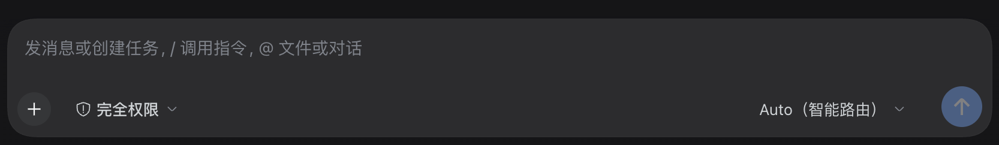
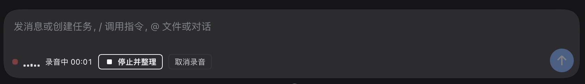

# dsh-voice-polish · Voice Input with Polish

Talk to your computer like you would send a voice message: transcription runs **on your local CPU** (SenseVoice), then DeepSeek **tidies your loose spoken words into a clean, ready-to-send paragraph** and inserts it into the composer draft. The experience matches Feishu/Lark's "smart" voice input.

English | [中文](README.zh.md)

## Why not just the official voice input?

DSH's built-in experimental voice bundle stops at "transcribe → insert raw text". Whatever mess you spoke is what lands in your draft: fillers, repeats, half sentences, homophone typos and all.

This plugin adds the missing layer: **after transcription, before insertion, a model tidies what you said**.

```
🎤 speak → local SenseVoice transcript → DeepSeek tidy-up → review panel → draft
```

Real example (spoken transcript → tidied):

> **Raw**: I want to ask you, so like, is there that voice input feature now? Like I just talk to the computer and then it, um, tidies it into text for me. Ideally like that tidies up my, uh, colloquial expressions before sending. That's it, thanks.
>
> **Tidied**: I want to ask: is there a voice input feature now? I'd talk to the computer and it would tidy my speech into text — ideally tidying up colloquial phrasing before sending. Thanks.

No expansion, no summarizing, no added content — just tidy. Homophone typos from the recognizer get fixed on the way.

## Interface

Before (native composer toolbar):



After (the Voice button appears):


Recording in progress (live level + timer; "Stop & tidy" transcribes and tidies):



## Features

- **Microphone button in the composer toolbar** — click to start, "Stop & tidy" to finish; live level bar + timer; Esc or Cancel discards
- **Local recognition** — SenseVoiceSmall (ONNX, CPU), auto / zh / en / yue / ja / ko; one-time model download (int8 ≈ 239 MB) with automatic HuggingFace / HF-Mirror fallback, fully offline afterwards
- **Review panel** — the tidied text is editable; toggle raw transcript, re-tidy, or insert raw — **a failed tidy never loses your words**
- **Three tidy-up styles** — `light` (fillers + punctuation only), `standard` (Feishu-like, default), `strict` (further written-form normalization)
- **Zero extra setup** — tidying reuses the DeepSeek route already configured in your profile; no new API keys
- Light/dark theme safe (all host theme tokens)

## Privacy

- Audio is transcribed inside your machine's process and **never leaves it**
- Only the **text transcript** is sent to your configured model for tidying (usually a few hundred tokens)
- Nothing is persisted; results become a session message only when you press send

## Install & first run

1. Install this plugin (pick one):
   - **DSH plugin market** (dshmarket / Discover tab): search `dsh-voice-polish` and one-click install
   - **CLI · prebuilt Release tarball** (no build-script approval, recommended):
     ```sh
     dsh plugin --profile <profile> add https://github.com/howie79794-sys/dsh-voice-polish/releases/download/v1.0.0/dsh-voice-polish-1.0.0.tgz
     ```
   - **CLI · GitHub source**: `dsh plugin --profile <profile> add github:howie79794-sys/dsh-voice-polish`
2. Refresh the page — a "🎤 Voice" button appears in the composer toolbar
3. First click walks you through the one-time local model download; allow microphone access in the browser and the OS
4. Speak

## Configuration

Edit the `voice-polish` row's `config` in your profile patch (toggle the plugin once to apply):

| Field | Default | Notes |
|---|---|---|
| `language` | `auto` | Recognition hint: `auto` / `zh` / `en` / `yue` / `ja` / `ko` |
| `style` | `standard` | Tidy-up level: `light` / `standard` / `strict` |
| `polishProvider` | `deepseek-official` | Model route for tidying; falls back to a configured DeepSeek route automatically |
| `polishModel` | `deepseek-chat` | Model for tidying |
| `maxDurationSeconds` | `180` | Per-recording limit |
| `enabled` | `true` | Master switch |

## Compatibility

- Requires DSH **0.2.2-rc.1+** (which ships the local recognition base).
- **Do not enable the official "Voice Input" bundle at the same time** — both register the same local recognizer. Disable one first if you want to switch.
- Browser microphone capture requires HTTPS or a loopback address (DSH Desktop / local `dsh web` satisfy this).

## How it works (for developers)

- Host half: loopback route `/api/voice-polish` (`status` / `prepare` / `dictate` / `polish`); transcription via `ctx.speechToText`, tidying via `ctx.llm.prepareCall().stream()`
- Client half: registers into the `conversation.input.activity` slot; `MediaRecorder` capture → Web Audio resample to 16 kHz mono PCM16 WAV → base64 upload
- Recording pipeline adapted from `@deepseek-ai/dsh-experimental-client-ui-voice-input` (MIT, DeepSeek)

## License

MIT — see [LICENSE](LICENSE).
