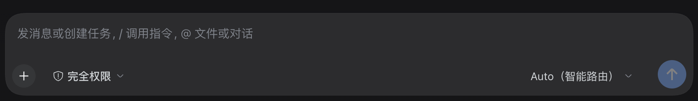
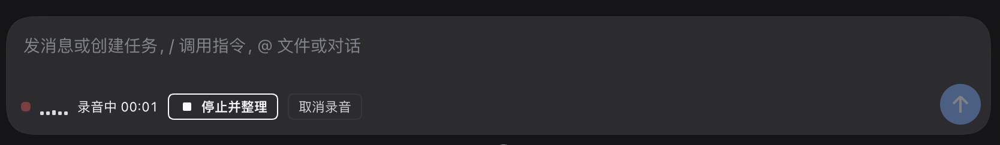

# dsh-voice-polish · 语音输入（口语整理）

对着麦克风说话，就像发微信语音一样——插件在**本机 CPU** 上完成识别（SenseVoice），再用 DeepSeek 把你松散的口语**整理成一段通顺的文字**，插回输入框草稿，你过目后发送。体验对齐飞书语音输入的「智能整理」。

[English](README.md) | 中文

## 为什么不是直接用官方语音输入

DSH 自带的实验性语音包只做「转写 → 插原文」。你说的话有多随便，插进草稿的就是多随便：语气词、重复、半截句、同音错别字全都在。

本插件补上关键的一层：**转写之后、落笔之前，让模型把你的话理通顺**。

```
🎤 说话 → 本地 SenseVoice 转写 → DeepSeek 整理口语 → 对照面板 → 插入草稿
```

实测一例（口语转写 → 整理稿）：

> **转写**：我想问你一下，就是现在有没有那个语音输入的功能啊？就是我直接对着电脑说话，然后他帮我整理成文字。嗯，最好是那种把我这个**好语化**的表达呀，整理好了再发出去的那种，就这样，谢谢。
>
> **整理稿**：我想问你一下，现在有没有语音输入的功能？就是我直接对着电脑说话，然后它帮我整理成文字。最好是那种能把我口语化的表达整理好了再发出去的，谢谢。

注意整理稿还顺手纠正了识别器的同音错字（好语化 → 口语化），且没有扩写、没有总结、没有加戏。

## 界面

安装前（原生输入框工具行）：



安装后（工具行出现「语音」按钮）：


录音进行中（实时音量 + 计时，点「停止并整理」即转写并整理）：



## 功能

- **输入框麦克风按钮**：点一下开始，说完点「停止并整理」；实时音量条 + 计时；Esc 或「取消」丢弃
- **本地识别**：SenseVoiceSmall（ONNX，CPU），支持 自动 / 中 / 英 / 粤 / 日 / 韩；模型一次性下载（int8 约 239 MB），HuggingFace 与 HF-Mirror 自动回退，之后可完全离线
- **对照面板**：整理稿可直接编辑；一键查看原文 / 重新整理 / 插入原文——**整理失败绝不丢字**
- **三档整理力度**：`light`（只去语气词、修标点）/ `standard`（飞书式整理，默认）/ `strict`（进一步书面化）
- **零额外配置**：整理复用你 profile 里已配好的 DeepSeek 模型路由，不需要任何新 API key
- 明暗主题自适应（全部使用宿主主题 token）

## 隐私

- 录音只在你本机进程内转写，**音频不出机器**
- 整理阶段只把**文字稿**发给你配置的模型（通常几百 token）
- 转写与整理结果不落盘、不进会话日志，只有你按下发送才成为消息

## 安装与首次使用

1. 安装本插件（三选一）：
   - **DSH 插件市场**（dshmarket / Discover 页）搜索 `dsh-voice-polish` 一键安装
   - **命令行 · Release 预构建包**（免构建脚本授权，推荐）：
     ```sh
     dsh plugin --profile <profile> add https://github.com/howie79794-sys/dsh-voice-polish/releases/download/v1.0.0/dsh-voice-polish-1.0.0.tgz
     ```
   - **命令行 · GitHub 源码**：`dsh plugin --profile <profile> add github:howie79794-sys/dsh-voice-polish`
2. 刷新页面，输入框工具行出现「🎤 语音」按钮
3. 首次点击按引导下载本地模型（一次性），并允许浏览器与系统麦克风权限
4. 开始说话

## 配置

编辑本 bundle 在 profile 补丁里的 `voice-polish` 行 `config`（改完在插件页开关一次生效）：

| 字段 | 默认 | 说明 |
|---|---|---|
| `language` | `auto` | 识别语言提示：`auto` / `zh` / `en` / `yue` / `ja` / `ko` |
| `style` | `standard` | 整理力度：`light` / `standard` / `strict` |
| `polishProvider` | `deepseek-official` | 整理用的模型路由；provider 不存在时自动回落到已配置的 DeepSeek 路由 |
| `polishModel` | `deepseek-chat` | 整理用的模型 |
| `maxDurationSeconds` | `180` | 单条录音上限 |
| `enabled` | `true` | 总开关 |

## 兼容性说明

- 需要 DSH **0.2.2-rc.1 及以上**（自带本地识别底座）。
- **不要与官方「语音输入」bundle 同时启用**：两者注册同一个本地识别器，会冲突。想切回官方体验，先停用本插件。
- 浏览器麦克风采集要求页面走 HTTPS 或环回地址（DSH 桌面端 / 本机 `dsh web` 天然满足）。

## 工作原理（开发者）

- 宿主半：环回路由 `/api/voice-polish`（`status` / `prepare` / `dictate` / `polish`）；转写走 `ctx.speechToText`，整理走 `ctx.llm.prepareCall().stream()`
- 客户端半：注册进 `conversation.input.activity` 插槽；`MediaRecorder` 采集 → Web Audio 重采样为 16 kHz 单声道 PCM16 WAV → base64 提交
- 录音管线改编自 `@deepseek-ai/dsh-experimental-client-ui-voice-input`（MIT，DeepSeek）

## 许可

MIT，见 [LICENSE](LICENSE)。
